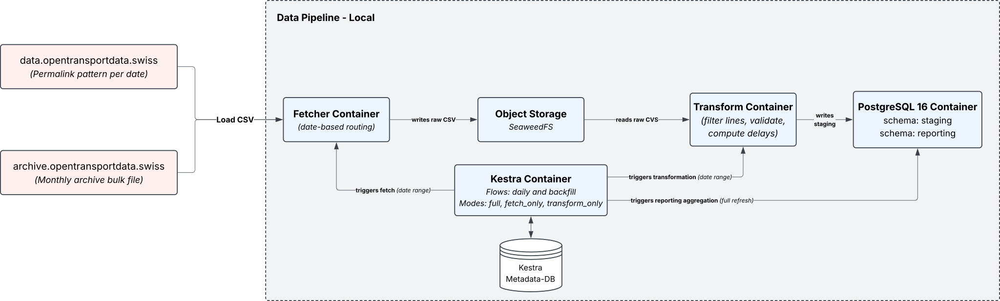

# Date Engineering (DENG) – Data Pipeline

Course project for **Data Engineering (DENG)** at HSLU, group 01.

Commuting students at the Rotkreuz campus want to know how late their train
usually is. This pipeline processes the SBB actual data ("Ist-Daten",
Open Transport Data Swiss) for selected lines and produces one data product:
the **median departure and arrival delay per line, origin–destination stop pair,
weekday and one-hour slot** (`reporting.od_delay_by_slot`).

The pipeline currently runs locally in Docker. Follow the setup below to get it running.

> **About this documentation**
> This README covers what the project does and how to run it. Each component has
> its own README that explains how it works and why it was built that way:
> architecture decisions, processing logic and the alternatives considered.
> See the [component overview](#pipeline-overview) for the links.



## Team

| Name | Focus |
|---|---|
| Til Fassbind | Transform, staging/reporting, orchestration |
| Alexander Türler | Fetcher, object storage |

## Pipeline overview

| Component | Responsibility | Docs |
|---|---|---|
| Fetcher Container | Downloads one CSV per operating day (permalink or monthly archive) and stores it unchanged | [fetcher/README.md](fetcher/README.md) |
| Object Storage | S3-compatible storage for raw files (SeaweedFS) | [docs/object-storage.md](docs/object-storage.md) |
| Transform Container | Filters the configured lines, validates timestamps, computes delays, upserts into staging | [transform/README.md](transform/README.md) |
| Aggregation | Stored procedure `reporting.refresh_od_delay()`, recomputes the data product | [db/README.md](db/README.md) |
| Orchestrator Container | Kestra with a scheduled `daily` flow and a parameterised `backfill` flow | [orchestrator/README.md](orchestrator/README.md) |

## Project structure

```
.
├── dataset/                 sample excerpt of the Ist-Daten
├── db/
│   └── init/                schemas, staging/reporting tables, stored procedure
├── docs/                    use case, project plan, architecture diagrams
├── fetcher/                 fetcher job (Python CLI, Dockerfile)
├── orchestrator/
│   ├── flows/               Kestra flows: daily.yml, backfill.yml
│   └── kestra/              Kestra server configuration (application.yml)
├── transform/               transform job (Python CLI, line config, Dockerfile)
├── .env.example             template for all configuration values
├── docker-compose.yml       all services
└── README.md
```

## Setup

### Prerequisites

- Docker Engine with Docker Compose v2 (`docker compose version`)
    - (Windows and macOS see: https://docs.docker.com/desktop/)
    - (Linux see: https://docs.docker.com/engine/install/)
- Git (see: https://git-scm.com/downloads)
- Internet access (the fetcher downloads from data.opentransportdata.swiss)

### 1. Clone
#### via SSH

```bash
git clone git@github.com:tgfassbind/DataEngineering.git
cd DataEngineering
```

#### via HTTPS
```bash
git clone https://github.com/tgfassbind/DataEngineering.git
cd DataEngineering
```

### 2. Configure

```bash
cp .env.example .env
```

Set at least:

| Variable | Why |
|---|---|
| `HOST_PROJECT_DIR` | Absolute path of this repo on the host (`pwd`). Kestra starts the jobs with `docker compose run` and needs the repo mounted under the identical path. |
| `KESTRA_BASIC_AUTH_USERNAME` / `KESTRA_BASIC_AUTH_PASSWORD` | Kestra login. The user name must be an e-mail address. The password needs ≥ 8 characters with upper case, lower case and a digit. |
| `POSTGRES_PASSWORD` | Password of the pipeline database. |

All other values have working defaults and are explained in `.env.example`.

### 3. Build and start

```bash
docker compose --profile jobs build   # builds the fetcher and transform images (required once and after code changes)
docker compose up -d                  # object-storage, database, kestra-db, kestra
docker compose ps                     # wait until everything is healthy
```

Fetcher and transform are jobs (profile `jobs`). They do not run permanently.
Kestra or you start them on demand.

### 4. Load data

**Option A – Kestra**

1. Open <http://localhost:8080> and log in.
2. Go to **Flows → namespace `deng` → `backfill`** and execute it with a date range,
   e.g. `2026-09-01` to `2026-09-30`.
3. Each day runs fetch → transform, then the aggregation refreshes the reporting table.

From then on, the `daily` flow processes yesterday's data every morning (06:15 Europe/Zurich).

**Option B – run the jobs by hand**

```bash
docker compose run --rm fetcher --start-date 2026-09-01 --end-date 2026-09-30
docker compose run --rm transform --start-date 2026-09-01 --end-date 2026-09-30
docker compose exec database psql -U deng -d deng -c "CALL reporting.refresh_od_delay();"
```

or for one day

```bash
docker compose run --rm fetcher --date 2026-09-30
docker compose run --rm transform --date 2026-09-30
docker compose exec database psql -U deng -d deng -c "CALL reporting.refresh_od_delay();"
```

#### Re-running and forcing

All steps are safe to re-run. By default nothing is loaded twice:

| Step | Default on re-run | Force |
|---|---|---|
| Fetcher | Days already in object storage are skipped (`SKIPPED`) | `--force-overwrite` downloads the day again and replaces the raw file |
| Transform | Upsert by row hash: only new or changed rows are written | `--retransform` deletes the day (for the configured lines) and loads it from scratch |
| Aggregation | Always recomputes the whole reporting table | – |

Examples:

```bash
# source data for a day was corrected: fetch again, then rebuild staging
docker compose run --rm fetcher --date 2026-09-30 --force-overwrite
docker compose run --rm transform --date 2026-09-30 --retransform
docker compose exec database psql -U deng -d deng -c "CALL reporting.refresh_od_delay();"

# transform logic or line config changed: raw files are fine, only rebuild staging
docker compose run --rm transform --start-date 2026-09-01 --end-date 2026-09-30 --retransform
```

In Kestra, the `backfill` flow covers the same cases through its inputs:

| Input | Values | Effect |
|---|---|---|
| `mode` | `full` (default) | fetch → transform (upsert) → aggregation |
| | `fetch_only` | fetch only; staging and reporting stay untouched |
| | `transform_only` | transform with `--retransform` → aggregation; raw files stay untouched |
| `force_overwrite` | `true` / `false` (default) | passes `--force-overwrite` to the fetcher; ignored in `transform_only` |
| `lines` | e.g. `IR75:SBB,S1:SBB` (optional) | overrides `transform/config/lines.yml` for this run |

To fully rebuild a day after the source data was corrected, run `fetch_only` with
`force_overwrite: true`, then `transform_only` for the same range.

### 5. Check the result

```bash
docker compose exec database psql -U deng -d deng -c "
  SELECT from_stop, to_stop, weekday, slot_hour,
         median_dep_delay_min, median_arr_delay_min, n_arr_obs
  FROM reporting.od_delay_by_slot
  WHERE from_stop = 'Rotkreuz'
  ORDER BY weekday, slot_hour
  LIMIT 10;"
```

PostgreSQL is also published on `127.0.0.1:5432` for any SQL client. An optional
pgAdmin is available with `docker compose --profile tools up -d`.

### Reset the database

The scripts in `db/init` only run when the database volume is empty. After
changing them, or the database credentials, recreate the volume:

```bash
docker compose down
docker volume rm deng-datapipeline_db-data
docker compose up -d
```

> Do **not** use `docker compose down -v`. It also deletes the object storage
> volume with all downloaded raw files and the Kestra history.

## Use of AI

We used Claude (Anthropic) as an assistant throughout the project.

**What the AI did**
- wrote parts of the code of the fetcher, the transform, the aggregation
  procedure and the Kestra flows
- reviewed and explained code on request
- drafted the documentation

**What we did**
- defined the use case, the data product and the architecture, and made all design
  decisions
- wrote the specifications for each component
- reviewed the generated code, went through it file by file until we understood it,
  and applied changes to the repository ourselves
- tested the pipeline on our machines with real data and reported bugs found there
  (e.g. the S1 line appearing in two networks)
- reviewed and adapted the documentation; the design decisions describe our reasoning

We are responsible for the content of this repository, including the parts written
with AI support.