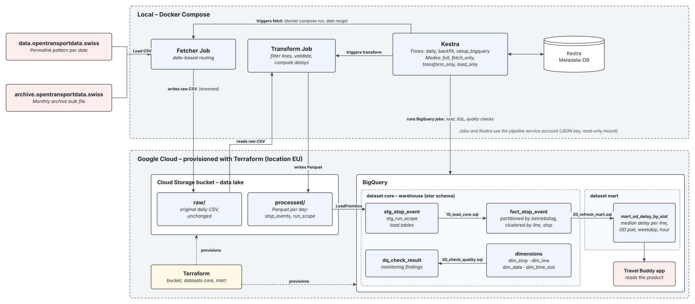

# Data Engineering (DENG) – Data Pipeline

Course project for **Data Engineering (DENG)** at HSLU, group 01.

Commuting students at the Rotkreuz campus want to know how late their train
usually is. This pipeline processes the SBB actual data ("Ist-Daten",
Open Transport Data Swiss) for selected lines and produces one data product:
the **median departure and arrival delay per line, origin–destination stop pair,
weekday and one-hour slot** (`mart.mart_od_delay_by_slot` in BigQuery).

The data lives in Google Cloud (Cloud Storage as data lake, BigQuery as warehouse),
provisioned with Terraform. The jobs and the orchestrator (Kestra) run locally in
Docker. Follow the setup below to run it in your own Google Cloud project.

> **About this documentation**
> This README covers what the project does and how to run it. Each component has
> its own README that explains how it works and why it was built that way:
> processing logic, design decisions and the alternatives considered.
> See the [component overview](#pipeline-overview) for the links.



## Team

| Name | Focus |
|---|---|
| Til Fassbind | Transform, data model and BigQuery, orchestration |
| Alexander Türler | Fetcher, data lake |

## Pipeline overview

```
SBB Ist-Daten ──fetch──► gs://<bucket>/raw/            data lake, original daily files
              ──transform──► gs://<bucket>/processed/  validated rows (Parquet)
              ──load──► BigQuery core                  star schema
              ──refresh──► BigQuery mart               data product
```

| Component | Responsibility | Docs |
|---|---|---|
| Terraform | Creates the bucket and the BigQuery datasets `core` and `mart` | [terraform/README.md](terraform/README.md) |
| Fetcher | Downloads one CSV per operating day (permalink or monthly archive) and stores it unchanged in `raw/` | [fetcher/README.md](fetcher/README.md) |
| Transform | Filters the configured lines, validates timestamps, computes delays, writes Parquet to `processed/` | [transform/README.md](transform/README.md) |
| BigQuery SQL | Star schema (fact and dimensions), data mart, data-quality checks | [bigquery/README.md](bigquery/README.md) |
| Orchestrator | Kestra: scheduled `daily` flow, parameterised `backfill` flow, one-time `setup_bigquery` | [orchestrator/README.md](orchestrator/README.md) |

Cross-cutting documentation:

| Topic | Docs |
|---|---|
| Data model: grain of every table, keys, partitioning, design decisions | [docs/data_model.md](docs/data_model.md) |
| Data quality: checks of every step, failure handling, reruns | [docs/data_quality.md](docs/data_quality.md) |
| Architecture and its evolution since v0.1 | [docs/architecture.md](docs/architecture.md) |

## Project structure

```
.
├── bigquery/sql/            tables, load, data mart and quality-check SQL
├── dataset/                 sample excerpt of the Ist-Daten (test fixture)
├── docs/                    use case, project plan, architecture, data model, data quality
├── fetcher/                 fetcher job (Python CLI, Dockerfile)
├── orchestrator/
│   ├── flows/               Kestra flows: daily, backfill, setup_bigquery
│   └── kestra/              Kestra server configuration (application.yml)
├── terraform/               Google Cloud infrastructure (bucket, datasets)
├── transform/               transform job (Python CLI, line config, Dockerfile)
├── .env.example             template for all configuration values
├── docker-compose.yml       jobs and Kestra
└── README.md
```

## Setup

### Prerequisites

- A **Google Cloud project** with billing enabled (the free tier covers BigQuery at
  this size; see [Costs](#costs))
- **Terraform** ≥ 1.11.4 (see: https://developer.hashicorp.com/terraform/install)
- **Docker Engine** with Docker Compose v2 (`docker compose version`)
    - (Windows and macOS see: https://docs.docker.com/desktop/)
    - (Linux see: https://docs.docker.com/engine/install/)
- **Git** (see: https://git-scm.com/downloads)
- Internet access (the fetcher downloads from opentransportdata.swiss)
- Free local disk space for one monthly archive ZIP (about 1.5 GB) while a past
  month is fetched; the raw files themselves go straight to the bucket.

### 1. Clone

```bash
git clone https://github.com/tgfassbind/DataEngineering.git
cd DataEngineering
```

(or via SSH: `git clone git@github.com:tgfassbind/DataEngineering.git`)

### 2. Service accounts

In the Google Cloud Console (**IAM & Admin → Service Accounts**) create two service
accounts, each with a JSON key. Store the keys **outside the repository**, e.g. in
`~/.config/deng/keys/`.

| Service account | Used by | Project roles |
|---|---|---|
| `terraform` | Terraform, from your terminal | Storage Admin, BigQuery Admin |
| `pipeline` | Kestra, fetcher, transform | Storage Object User, Storage Bucket Viewer, BigQuery Job User, BigQuery Data Editor |

Details and reasoning: [terraform/README.md](terraform/README.md).

### 3. Cloud infrastructure

```bash
cd terraform
export GOOGLE_APPLICATION_CREDENTIALS="$HOME/.config/deng/keys/terraform.json"
cp terraform.tfvars.example terraform.tfvars   # set project_id and bucket_name
terraform init
terraform plan        # 3 to add: bucket, datasets core and mart
terraform apply
terraform output      # bucket_url, datasets
cd ..
```

### 4. Configure

```bash
cp .env.example .env
```

Set at least:

| Variable | Why |
|---|---|
| `GCS_BUCKET` | Bucket name: Terraform output `bucket_url` without `gs://`. |
| `GCP_PROJECT_ID` | Your Google Cloud project ID. |
| `GCP_LOCATION` | Location of bucket and datasets (Terraform `location`, default `EU`). |
| `GCP_PIPELINE_KEY_FILE` | Absolute path of the **pipeline** service account's JSON key. It is mounted read-only into the containers. |
| `HOST_PROJECT_DIR` | Absolute path of this repo on the host (`pwd`). Kestra starts the jobs with `docker compose run` and needs the repo mounted under the identical path. |
| `KESTRA_BASIC_AUTH_USERNAME` / `KESTRA_BASIC_AUTH_PASSWORD` | Kestra login. The user name must be an e-mail address. The password needs ≥ 8 characters with upper case, lower case and a digit. |
| `KESTRA_DB_PASSWORD` | Password of Kestra's own metadata database. |

All other values have working defaults and are explained in `.env.example`.

### 5. Build and start

```bash
docker compose --profile jobs build   # fetcher and transform images (once and after code changes)
docker compose up -d                  # kestra-db, kestra
docker compose ps                     # wait until both are healthy (1–2 minutes)
```

Fetcher and transform are jobs (profile `jobs`). They do not run permanently;
Kestra or you start them on demand.

### 6. Create the BigQuery tables

Open <http://localhost:8080>, log in, go to **Flows → namespace `deng` →
`setup_bigquery`** and execute it once. It creates the tables and fills the calendar
dimensions; the last log line lists the tables of `core` and `mart`. Safe to rerun.

### 7. Load data

**Option A – Kestra (normal operation)**

Execute **`backfill`** with a date range, e.g. `2026-09-01` to `2026-09-07`,
mode `full`. Each run fetches, transforms and loads every day of the range, then
refreshes the data mart and runs the data-quality checks.

From then on, the `daily` flow processes yesterday's data every morning
(06:15 Europe/Zurich), as long as Kestra is running.

**Option B – run the jobs by hand**

The jobs write to the bucket only; loading into BigQuery is a Kestra step.

```bash
docker compose run --rm fetcher --start-date 2026-09-01 --end-date 2026-09-07
docker compose run --rm transform --start-date 2026-09-01 --end-date 2026-09-07
```

then `backfill` with mode `load_only` for the same range.

#### Re-running and forcing

All steps are safe to re-run:

| Step | On re-run | Force |
|---|---|---|
| Fetch | Days already in `raw/` are skipped (`SKIPPED`) | `--force-overwrite` / `force_overwrite: true` downloads the day again and replaces the raw file |
| Transform | Writes the day's files in `processed/` again | – |
| Load | Replaces the processed days and lines in the fact table | – |
| Data mart | Always recomputed in full | – |

The `backfill` flow covers the usual cases through its `mode`:

| `mode` | Steps | Typical use |
|---|---|---|
| `full` (default) | fetch → transform → load → mart → quality checks | normal backfill |
| `fetch_only` | fetch | download only |
| `transform_only` | transform → load → mart → quality checks | transform logic or `lines.yml` changed |
| `load_only` | load → mart → quality checks | BigQuery SQL changed, or a load failed |

To fully rebuild a day after the source data was corrected: `full` with
`force_overwrite: true` for that day.

### 8. Check the result

In BigQuery Studio:

```sql
SELECT linien_text, from_stop, to_stop, weekday, slot_hour,
       median_dep_delay_min, median_arr_delay_min, n_arr_obs
FROM mart.mart_od_delay_by_slot
WHERE from_stop = 'Rotkreuz'
ORDER BY linien_text, to_stop, weekday, slot_hour
LIMIT 20;
```

Data-quality findings of the last run:

```sql
SELECT check_name, status, betriebstag, details
FROM core.dq_check_result
WHERE checked_at = (SELECT MAX(checked_at) FROM core.dq_check_result)
ORDER BY status DESC, check_name;
```

More queries: [docs/data_quality.md](docs/data_quality.md#queries).

## Costs

Nothing runs permanently in Google Cloud: the jobs and Kestra run locally, the cloud
only stores data and runs BigQuery jobs.

- **Cloud Storage:** the raw files are kept unchanged, about 650 MB per operating
  day (about 20 GB per month). Billed per GB and month; see
  [Cloud Storage pricing](https://cloud.google.com/storage/pricing).
- **BigQuery:** only the selected lines are loaded (a few thousand rows per day);
  storage and queries stay far inside the monthly free tier.

We recommend a budget alert (**Billing → Budgets & alerts**). To remove everything
after the project: empty the bucket, then `terraform destroy` (it refuses to delete
a bucket or dataset that still contains data).

## Verification

Checks that your setup works and produces the same data as ours.

### 1. Infrastructure and stack

```bash
cd terraform && terraform plan && cd ..   # "No changes."
docker compose ps                         # kestra-db and kestra healthy
```

In Kestra, the flows `daily`, `backfill` and `setup_bigquery` are listed in namespace
`deng`, and `setup_bigquery` ran green.

### 2. End to end (real data)

Loads a fixed, closed week through Kestra. Past months come from the monthly
archive, so every team downloads the same files.

Execute `backfill` with `start_date = 2026-09-01`, `end_date = 2026-09-07`,
`mode = full`, `force_overwrite = false`, `lines` empty. All tasks must be green.

**Raw files**

```bash
docker compose run --rm --entrypoint python fetcher -m app.inventory | grep '2026-09-0[1-7]'
```

The filter keeps the reference week, so other loaded days do not matter.

```
raw/2026-09-01_istdaten.csv             670052892  747541de660e1866bf8285a01736edcd
raw/2026-09-02_istdaten.csv             672336538  6f00aaa0805686ef4bb3774470e1c4ba
raw/2026-09-03_istdaten.csv             671958240  a0d353e1c2e69fa3f5944c169cd871cb
raw/2026-09-04_istdaten.csv             679017602  74fc2de2bd28bfdfcc3dcd79b138f904
raw/2026-09-05_istdaten.csv             555708040  7483afbabc7a1961be1c987c994d4d27
raw/2026-09-06_istdaten.csv             434998310  bdb981980a849b0772d9e928f8966831
raw/2026-09-07_istdaten.csv             667246777  c4f8ea3350dbbd07fb5a4e5c620d3dd2
```

**Fact table, fingerprint per day**

Independent of other loaded days. The fingerprint covers every column except
`loaded_at`, so the same fingerprint means the same content, row by row.

```sql
SELECT betriebstag, COUNT(*) AS fact_rows,
       BIT_XOR(FARM_FINGERPRINT(TO_JSON_STRING(f))) AS fingerprint
FROM (SELECT * EXCEPT (loaded_at) FROM core.fact_stop_event
      WHERE betriebstag BETWEEN '2026-09-01' AND '2026-09-07') AS f
GROUP BY betriebstag
ORDER BY betriebstag;
```

| betriebstag | fact_rows | fingerprint |
|---|---|---|
| 2026-09-01 | 2842 | -6043014123570813980 |
| 2026-09-02 | 2857 | 5076244706989203856 |
| 2026-09-03 | 2858 | 7447574047709995743 |
| 2026-09-04 | 2862 | -2108112285638568410 |
| 2026-09-05 | 2754 | 6603785114222836667 |
| 2026-09-06 | 2205 | -3507826482310514249 |
| 2026-09-07 | 2866 | 6686182917701743649 |

**Dimensions**

The four dimensions of the star schema. `dim_stop` and `dim_line` are limited to the
members used by the reference week; `source_day` and `updated_at` are left out,
because they depend on when and in which order days were loaded.

```sql
SELECT 'dim_stop' AS dimension, COUNT(*) AS row_count,
       BIT_XOR(FARM_FINGERPRINT(TO_JSON_STRING(d))) AS fingerprint
FROM (SELECT stop_key, bpuic, haltestellen_name FROM core.dim_stop
      WHERE stop_key IN (SELECT stop_key FROM core.fact_stop_event
                         WHERE betriebstag BETWEEN '2026-09-01' AND '2026-09-07')) AS d
UNION ALL
SELECT 'dim_line', COUNT(*), BIT_XOR(FARM_FINGERPRINT(TO_JSON_STRING(d)))
FROM (SELECT line_key, linien_text, betreiber_abk, betreiber_name,
             verkehrsmittel_text, produkt_id FROM core.dim_line
      WHERE line_key IN (SELECT line_key FROM core.fact_stop_event
                         WHERE betriebstag BETWEEN '2026-09-01' AND '2026-09-07')) AS d
UNION ALL
SELECT 'dim_date', COUNT(*), BIT_XOR(FARM_FINGERPRINT(TO_JSON_STRING(d)))
FROM core.dim_date AS d
UNION ALL
SELECT 'dim_time_slot', COUNT(*), BIT_XOR(FARM_FINGERPRINT(TO_JSON_STRING(d)))
FROM core.dim_time_slot AS d
ORDER BY dimension;
```

| dimension | row_count | fingerprint |
|---|---|---|
| dim_date | 6574 | -5810570563403347798 |
| dim_line | 2 | -435106981609598615 |
| dim_stop | 32 | -37740699015524814 |
| dim_time_slot | 24 | 8299245875725392440 |

Stops and lines are SCD type 1: if a stop was renamed after the reference week and
later days are loaded, its current name differs and so does the fingerprint.

**Referential integrity**

Every fact row of the reference week has its dimension rows. All values must be 0.

```sql
SELECT
  COUNTIF(s.stop_key IS NULL) AS missing_stop,
  COUNTIF(l.line_key IS NULL) AS missing_line,
  COUNTIF(d.date IS NULL) AS missing_date,
  COUNTIF(f.arr_slot_hour IS NOT NULL AND ta.slot_hour IS NULL)
    + COUNTIF(f.dep_slot_hour IS NOT NULL AND td.slot_hour IS NULL) AS missing_slot
FROM core.fact_stop_event AS f
LEFT JOIN core.dim_stop AS s ON s.stop_key = f.stop_key
LEFT JOIN core.dim_line AS l ON l.line_key = f.line_key
LEFT JOIN core.dim_date AS d ON d.date = f.betriebstag
LEFT JOIN core.dim_time_slot AS ta ON ta.slot_hour = f.arr_slot_hour
LEFT JOIN core.dim_time_slot AS td ON td.slot_hour = f.dep_slot_hour
WHERE f.betriebstag BETWEEN '2026-09-01' AND '2026-09-07';
```

| missing_stop | missing_line | missing_date | missing_slot |
|---|---|---|---|
| 0 | 0 | 0 | 0 |

**Star schema query**

An analysis through fact and dimensions: arrivals at Rotkreuz in the reference
week, per line and weekday / weekend. It joins `dim_stop` (filter by name),
`dim_line` (line text) and `dim_date` (weekend flag), and checks that the joins give
the same figures everywhere.

```sql
SELECT l.linien_text,
       d.is_weekend,
       COUNT(*)                                      AS served_stops,
       COUNT(f.arr_delay_s)                          AS arrivals_measured,
       ROUND(AVG(f.arr_delay_s) / 60, 2)             AS avg_arr_delay_min,
       ROUND(100 * COUNTIF(f.arr_delay_s >= 180)
             / COUNT(f.arr_delay_s), 1)              AS pct_late_3min_plus
FROM core.fact_stop_event AS f
JOIN core.dim_stop AS s ON s.stop_key = f.stop_key
JOIN core.dim_line AS l ON l.line_key = f.line_key
JOIN core.dim_date AS d ON d.date = f.betriebstag
WHERE f.betriebstag BETWEEN '2026-09-01' AND '2026-09-07'
  AND s.haltestellen_name = 'Rotkreuz'
GROUP BY l.linien_text, d.is_weekend
ORDER BY l.linien_text, d.is_weekend;
```

| linien_text | is_weekend | served_stops | arrivals_measured | avg_arr_delay_min | pct_late_3min_plus |
|---|---|---|---|---|---|
| IR75 | false | 188 | 188 | 0.76 | 2.1 |
| IR75 | true | 76 | 76 | 0.67 | 3.9 |
| S1 | false | 731 | 571 | 0.75 | 6.1 |
| S1 | true | 213 | 185 | 1.08 | 10.8 |

**Data product for the reference week**

The mart covers every loaded day. This query computes its row count for the
reference week alone, with the same logic, so it can be compared even if other
days are loaded:

```sql
WITH pairs AS (
  SELECT a.line_key, a.stop_key AS from_stop_key, b.stop_key AS to_stop_key,
         MOD(EXTRACT(DAYOFWEEK FROM a.sched_dep) + 5, 7) + 1 AS weekday,
         a.dep_slot_hour AS slot_hour, a.dep_delay_s, b.arr_delay_s
  FROM core.fact_stop_event AS a
  JOIN core.fact_stop_event AS b
    ON b.betriebstag = a.betriebstag AND b.fahrt_bezeichner = a.fahrt_bezeichner
   AND b.stop_sequence > a.stop_sequence
  WHERE a.sched_dep IS NOT NULL
    AND a.betriebstag BETWEEN '2026-09-01' AND '2026-09-07'
)
SELECT COUNT(*) AS mart_rows,
       COUNT(DISTINCT FORMAT('%d-%d', from_stop_key, to_stop_key)) AS stop_pairs
FROM (SELECT line_key, from_stop_key, to_stop_key, weekday, slot_hour
      FROM pairs
      GROUP BY 1, 2, 3, 4, 5
      HAVING COUNT(dep_delay_s) > 0 OR COUNT(arr_delay_s) > 0);
```

| mart_rows | stop_pairs |
|---|---|
| 87100 | 671 |

If a check differs, the first layer that differs (raw → fact → dimensions → mart)
shows where to look.

## Known limitations

**Data product**

- **Only served stops.** Cancelled stops are excluded by design, so a line with
  many cancellations looks more reliable than it is
  ([data model](docs/data_model.md#design-decisions)).
- **Extreme delays are dropped.** Delays over 3 h and segments over 6 h are treated
  as invalid measurements. Real major disruptions are missing, the medians tend to
  be slightly optimistic ([transform](transform/README.md)).
- **Small groups.** Some combinations of line, stop pair, weekday and hour rest on
  few measurements; the app should show `n_dep_obs` / `n_arr_obs` with the median.
- **All loaded days count equally.** No weighting by age and no distinction of
  holidays or timetable periods; after the timetable change in December, old and
  new timetable mix.
- **Only the configured lines** (IR75 and S1 via Rotkreuz). Another line needs an
  entry in `transform/config/lines.yml` and a `transform_only` run for its days.

**Data and model**

- **Removed lines stay.** A line removed from `lines.yml` keeps its rows in the fact
  table and the mart until they are deleted by hand.
- **No history of names.** Stops and lines are SCD type 1: a renamed stop replaces
  the old name.
- **Source corrections need a re-fetch.** A corrected source file reaches BigQuery
  only after the day is fetched again with `force_overwrite`.
- **Schema changes are manual.** `CREATE TABLE IF NOT EXISTS` does not change an
  existing table; a new column needs a migration.
- **No automated tests for the BigQuery SQL.** Fetcher and transform have unit and
  end-to-end tests; the SQL is covered by the blocking checks and the reference week
  of the [verification](#verification).

**Operations and infrastructure**

- **Kestra runs locally.** `daily` runs only while the machine and Docker are up;
  missed days are caught up at the next start.
- **One run at a time.** A long backfill delays `daily` until it is done.
- **Warnings are not sent.** Monitoring findings are logged in Kestra and stored in
  `core.dq_check_result`; nobody is notified.
- **Raw files grow without limit.** About 650 MB per day, no lifecycle rule on the
  bucket (see [Costs](#costs)).
- **The mart is always recomputed in full.** Fine at the current size; time and
  scanned data grow with the history.
- **Service account keys as JSON files.** As in class; rotating and storing them
  safely is manual. In production, keyless authentication (e.g. Workload Identity)
  would be preferable.
- **Archive ZIP on local disk.** Past months are downloaded as one ZIP to a temporary
  local folder before the days are uploaded (agreed with the lecturer as temporary
  processing); this needs about 1.5 GB of free space.

## Use of AI

We used Claude (Anthropic) as an assistant throughout the project.

**What the AI did**
- wrote parts of the code of the fetcher, the transform, the BigQuery SQL, the
  Terraform configuration and the Kestra flows
- reviewed and explained code on request
- drafted the documentation

**What we did**
- defined the use case, the data product and the architecture, and made all design
  decisions
- wrote the specifications for each component
- reviewed the generated code, went through it file by file until we understood it,
  and applied changes to the repository ourselves
- set up the Google Cloud project, service accounts and infrastructure, and tested
  the pipeline on our machines and in the cloud with real data, reporting the bugs
  found there (e.g. the S1 line appearing in two networks)
- reviewed and adapted the documentation; the design decisions describe our reasoning

We are responsible for the content of this repository, including the parts written
with AI support.
