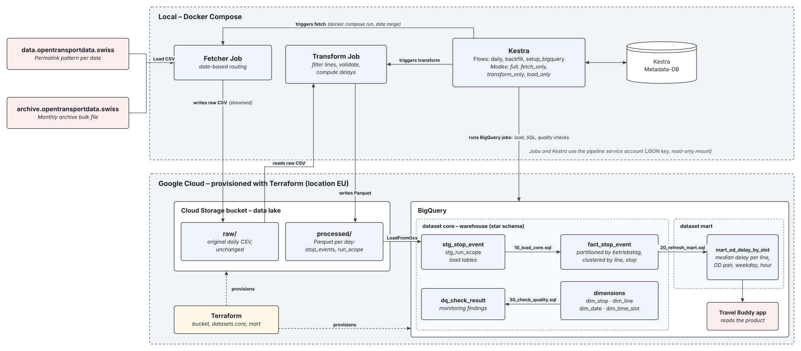

# Architecture

## Architecture v1.0

The data lives in Google Cloud, the processing is started locally:

| Layer | Where | Component | Docs |
|---|---|---|---|
| Sources | opentransportdata.swiss | permalink per day, monthly archive | – |
| Ingestion | local, Docker | fetcher job | [fetcher](../fetcher/README.md) |
| Data lake | Cloud Storage | `raw/` (original daily files), `processed/` (Parquet) | [fetcher](../fetcher/README.md), [transform](../transform/README.md) |
| Transformation | local, Docker | transform job: line filter, validation, delays | [transform](../transform/README.md) |
| Warehouse | BigQuery `core` | star schema: `fact_stop_event` and four dimensions | [data model](data_model.md) |
| Data product | BigQuery `mart` | `mart_od_delay_by_slot` | [data model](data_model.md) |
| Orchestration | local, Docker | Kestra: `daily`, `backfill`, `setup_bigquery`; BigQuery steps as Kestra tasks | [orchestrator](../orchestrator/README.md) |
| Data quality | BigQuery + jobs | blocking checks per step, monitoring results in `core.dq_check_result` | [data quality](data_quality.md) |
| Infrastructure | Terraform | bucket, datasets `core` and `mart` | [terraform](../terraform/README.md) |

Data flow of one operating day:

1. **Fetch:** the fetcher downloads the day's CSV (permalink, or the monthly archive
   for older months) and streams it unchanged to `raw/<day>_istdaten.csv`.
2. **Transform:** the transform reads the raw file, keeps the configured lines,
   validates every timestamp and writes `processed/<day>_stop_events.parquet` and
   `processed/<day>_run_scope.parquet`.
3. **Load:** Kestra loads both files into the load tables (`LoadFromGcs`);
   `10_load_core.sql` checks them and moves them into the star schema in one
   transaction.
4. **Data product:** `20_refresh_mart.sql` recomputes the mart; `30_check_quality.sql`
   records the monitoring checks.

Kestra runs steps 1–4 every morning for the previous day (`daily`) or on demand for
any date range (`backfill`). Fetcher, transform and Kestra authenticate with the
same pipeline service account; Terraform uses its own account.

## Evolution from v0.1

| | [v0.1](Architecture_V01.svg) – plan (midterm) | [v0.2](Architecture_V02.svg) – local implementation | v1.0 – cloud (final) |
|---|---|---|---|
| Sources | permalink + monthly archive | unchanged | unchanged |
| Fetcher | one fetcher, date-based routing | + permalink on the 1st of a month for the previous day | writes to Cloud Storage; archive ZIP only as temporary local file |
| Data lake | object storage | SeaweedFS container, S3 API | **Cloud Storage** bucket (Terraform), `raw/` + `processed/` |
| Transform | filter, harmonise, compute | + lines identified by stops (`via_bpuic`), hash upsert into staging | reads from and writes to the bucket (Parquet); no database access |
| Storage of results | PostgreSQL: `staging`, `reporting` | PostgreSQL container | **BigQuery**: `core` (star schema), `mart` |
| Data model | staging + reporting table | flat staging table, reporting table | **star schema**: `fact_stop_event` + `dim_stop`, `dim_line`, `dim_date`, `dim_time_slot`; mart with keys |
| Aggregation | "triggers aggregation" | stored procedure in PostgreSQL | BigQuery SQL run by Kestra (`20_refresh_mart.sql`) |
| Orchestrator | orchestrator container, daily + rerun | Kestra with own metadata DB; `daily`, `backfill` (`full`, `fetch_only`, `transform_only`) | Kestra stays local; + `load_only`, `setup_bigquery`; BigQuery steps as Kestra GCP tasks |
| Data quality | – | validation in the transform, header check in the fetcher | + blocking checks in load and mart refresh, monitoring table `dq_check_result` |
| Infrastructure | – | Docker Compose | + **Terraform** for bucket and datasets; two service accounts |
| Data product | mean delay per segment and slot | median, individual weekday | unchanged (same grain, same values) |

### What stayed

The structure of v0.1 held through both versions: two sources, one fetcher with
date-based routing, a storage layer that keeps the raw files unchanged, a transform
that selects and validates, a database layer with the data product, and an
orchestrator that triggers every step for a day or a date range. The data product
was settled during the local implementation (median instead of mean, individual
weekday) and has not changed since: the cloud version produces exactly the same
values as the local one for the reference week (see the
[verification](../README.md#verification)).

### What changed, and why

- **Local storage → Cloud Storage and BigQuery.** The final milestone requires a
  cloud data lake and warehouse. The fetcher's S3 client was replaced by the Google
  client; the key layout `raw/<day>_istdaten.csv` stayed. PostgreSQL was replaced,
  not kept in parallel: one pipeline is easier to run, test and explain.
- **Flat staging → star schema.** The local staging table already had the grain of
  a fact table (one served stop of one trip). It became `fact_stop_event`; stop and
  line attributes moved to dimensions with deterministic surrogate keys, and the
  calendar and hour slots became generated dimensions.
- **Transform writes files, not tables.** The validation stays in Python (complex,
  covered by tests); the modelling moved to BigQuery SQL. Writing Parquet to
  `processed/` keeps each step visible in Kestra and lets a load be repeated
  without transforming again.
- **Reruns by replacement instead of hash upsert.** A load replaces the processed
  days and lines in the fact table. Corrections and removed rows are handled the
  same way, without a separate retransform mode.
- **Kestra stays local.** Only the data moved to the cloud; Kestra reaches it
  through the APIs with the pipeline service account, as in class.
- **Explicit data quality.** Checks that PostgreSQL enforced (keys, foreign keys)
  are checked explicitly in BigQuery, and the pipeline records monitoring findings.

Details and reasoning: see the component READMEs and the linked documents.
